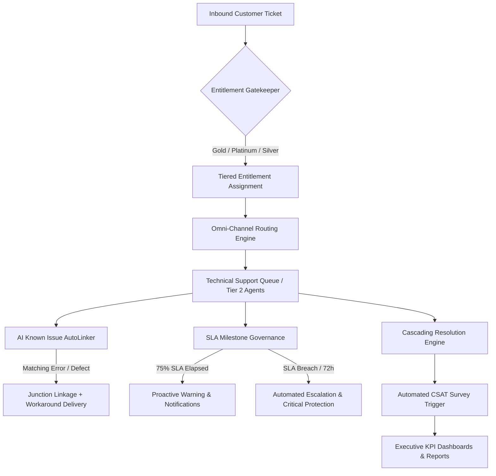

# TechNova Cloud Enterprise Service Cloud Architecture & System Design

## 1. System Overview

The **TechNova Enterprise Service Cloud** system is an enterprise-grade customer support automation suite implemented in Salesforce DX. It orchestrates the full lifecycle of support operations across automated intake, entitlement gatekeeping, omni-channel routing, AI-assisted defect linking, end-to-end SLA milestone governance, and executive KPI reporting.



---

## 2. Core Architectural Pillars

### Pillar 1: Smart Entitlement Gatekeeper
- **Component**: `Case_Entitlement_Gatekeeper` (Before-Save Record-Triggered Flow)
- **Function**: Automatically inspects the Account's customer tier (`Account.Customer__c`) and active customer subscriptions (`Customer_Product__c`).
- **SLA Mapping**:
  - **Platinum Tier**: 8-hour First Response, 72-hour Resolution SLA.
  - **Gold Tier**: 2-hour First Response, 24-hour Resolution SLA.
  - **Silver Tier**: 4-hour First Response, 48-hour Resolution SLA.
- **Master Entitlements**: Decoupled from static Account IDs and managed dynamically via dynamic SOQL utilities (`fixMasterEntitlements.apex`).

---

### Pillar 2: Technical Support Queue & Omni-Channel Routing
- **Queue**: `Technical_Support_Queue` (Case SObject, Omni-Channel enabled).
- **Routing Config**: `Case_Omni_Routing` (Routing Model: `MOST_AVAILABLE`, Priority: `1`).
- **Capacity Controls**: `Support_Agent_Omni_Config` allocates balanced capacity to active engineers.
- **Record Type**: `Technical_Support` dedicated layout and lifecycle tracking.

---

### Pillar 3: AI Defect Linker, Repeat Contact Intelligence & Cascading Resolution
- **Defect Matching**: `Case_Known_Issue_AutoLinker` matches 504 Gateway Timeout and critical keyword patterns against published `Known_Issue__c` records.
- **Junction Architecture**: Two-way Master-Detail junction `Case_Known_Issue__c` links Cases and Known Issues.
- **Immediate Workaround Delivery**: Automatically posts verified engineering workarounds to Case Chatter and emails the customer.
- **Repeat Contact Intelligence**: Sibling intake detection links repeat customer contacts to the primary root ticket.
- **Cascading Resolution Engine**: `Case_Cascading_Resolution_Engine` + `Known_Issue_Mass_Resolver` propagates permanent bug resolutions to all linked active customer cases in bulk.

---

### Pillar 4: Milestone Lifecycle & SLA Governance
- **Milestone Completion Engine**: Automated triggers on `EmailMessage` and Case closure resolve First Response and Resolution milestones instantly.
- **Proactive SLA Warnings**: Scheduled paths trigger warning Chatter feed items and Bell notifications at 75% elapsed milestone time.
- **Escalation Engine**: `Case_Escalation_Flow` escalates unaddressed high-priority cases at 48h and 72h thresholds with dynamic System Administrator Profile resolution (`Profile.Name = 'System Administrator'`).
- **Data Immutability & Lock**: `VR_Case_Lock_Customer_And_SLA_Data` prevents tampering with customer tiers or SLA metrics post-intake, with bypass delegated to Custom Permission `Bypass_Case_Lock`.
- **Customer CSAT Engine**: `Case_CSAT_Survey_Trigger` fires on Case closure, generating secure tokens and delivering customized survey invites.
- **Executive Visibility**: 4-pillar `Executive_Support_KPI_Dashboard` tracking CSAT, SLA compliance, ticket volume, and agent performance.

---

## 3. Deployment & DevOps Architecture

### Deploy-Time Replacements (`sfdx-project.json`)
To ensure complete portability across different developer sandboxes, scratch orgs, and production environments without exposing sensitive personal emails in Git:
- Placeholders such as `__ADMIN_USER__` are stored in repository metadata.
- Salesforce CLI v2 string replacements dynamically inject the target org's admin username at deploy time:
  ```json
  "replacements": [
    {
      "glob": "force-app/**/*-meta.xml",
      "stringToReplace": "__ADMIN_USER__",
      "replaceWithEnv": "ADMIN_USERNAME"
    }
  ]
  ```

### Developer Deployment Quick Start
1. Copy `.env.example` to `.env` and set your target org username:
   ```bash
   ADMIN_USERNAME="your.user@your-sandbox.com"
   ```
2. Deploy changes safely:
   ```bash
   ADMIN_USERNAME="your.user@your-sandbox.com" sf project deploy start
   ```

